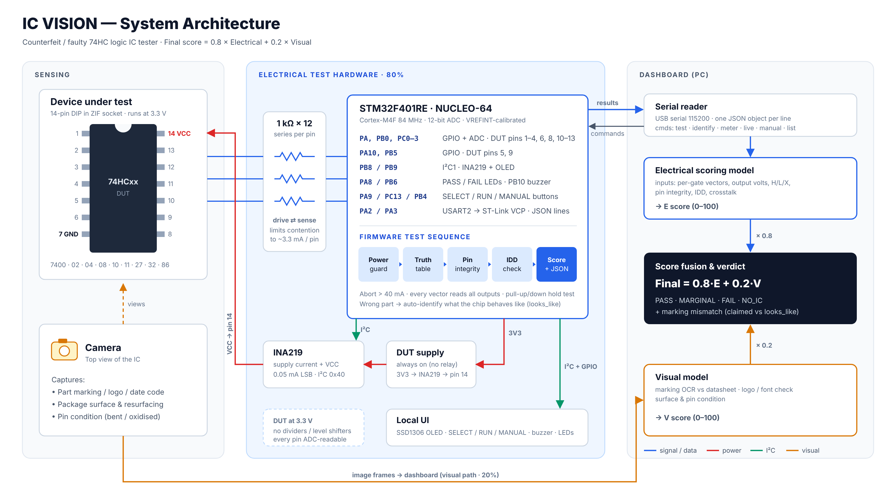
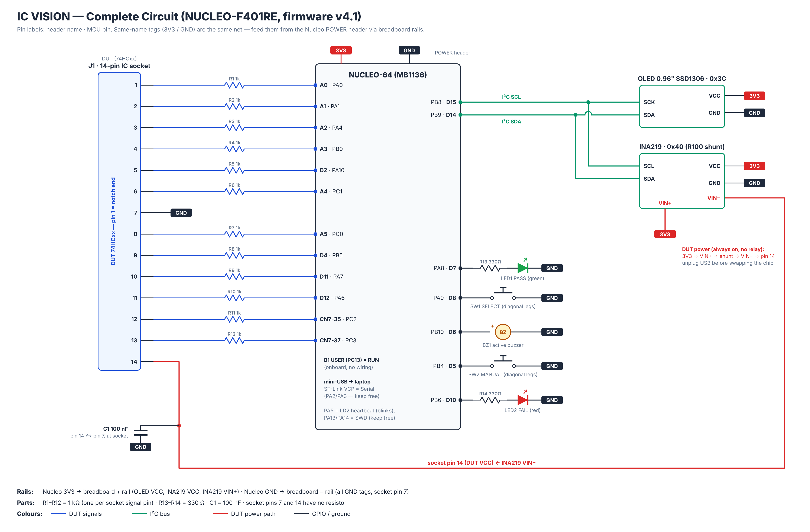

# STM32 IC Tester — IC VISION

Bare-metal HAL firmware for a **74HC 14-pin logic IC tester** on the **NUCLEO-F401RE** (STM32F401RE, Cortex-M4F @ 84 MHz).
It drives every input vector of every gate, reads all pins back on the 12-bit ADC, checks pin integrity and supply current, and
returns a 0–100 electrical score plus a PASS / MARGINAL / FAIL / NO_IC verdict, both on an OLED and as JSON over USB serial.

Built as the electrical half (80 %) of **IC VISION**, a counterfeit / faulty IC detection system. A PC dashboard combines this
score with a camera-based visual score (20 %). The project **won the hackathon**.



## Supported ICs

7400 · 7402 · 7404 · 7408 · 7410 · 7411 · 7427 · 7432 · 7486. These are 74HC parts in a 14-pin DIP (VCC = pin 14, GND = pin 7), and the chip runs at 3.3 V.

## Hardware



| Socket pin | Nucleo header | MCU pin | Notes |
|---|---|---|---|
| 1 | A0 | PA0 | 1 kΩ series, ADC |
| 2 | A1 | PA1 | 1 kΩ, ADC |
| 3 | A2 | PA4 | 1 kΩ, ADC |
| 4 | A3 | PB0 | 1 kΩ, ADC |
| 5 | D2 | PA10 | 1 kΩ, digital only |
| 6 | A4 | PC1 | 1 kΩ, ADC |
| 7 | GND | — | direct |
| 8 | A5 | PC0 | 1 kΩ, ADC |
| 9 | D4 | PB5 | 1 kΩ, digital only |
| 10 | D11 | PA7 | 1 kΩ, ADC |
| 11 | D12 | PA6 | 1 kΩ, ADC |
| 12 | CN7-35 | PC2 | 1 kΩ, ADC |
| 13 | CN7-37 | PC3 | 1 kΩ, ADC |
| 14 | — | — | 3V3 → INA219 VIN+ → shunt → VIN− → pin 14, 100 nF to pin 7 |

| Peripheral | Pins |
|---|---|
| 0.96" SSD1306 OLED (0x3C) + INA219 (0x40) | I²C1 — PB8 (D15) SCL, PB9 (D14) SDA |
| RUN / SELECT / MANUAL buttons (to GND) | PC13 (B1) / PA9 (D8) / PB4 (D5) |
| PASS / FAIL LEDs (330 Ω) | PA8 (D7) / PB6 (D10) |
| Active buzzer | PB10 (D6, TIM2_CH3) |
| Heartbeat | PA5 (LD2) |
| Host link | USART2 PA2/PA3 → ST-Link virtual COM port, 115200 8N1 |

The 1 kΩ series resistors let each socket pin be both driven and sensed, and they limit contention to about 3.3 mA if a pin is wrong.
The chip is always powered, so **unplug USB before swapping chips**.

## Test sequence

1. **Power guard** — all pins are set to high-Z first. The test aborts if IDD > 40 mA (reversed or shorted chip) or if VCC is outside 3.0–3.6 V.
2. **Truth table** — every vector of every gate is applied, and after each vector *all* outputs are read. An output that changes when it shouldn't is counted as crosstalk.
   H ≥ 0.7·VCC, L ≤ 0.3·VCC, anything in between is X. A level counts as "strong" when it is within 0.15 V of the rail.
3. **Pin integrity** — outputs must hold their level against the MCU pull-up and pull-down. Inputs must follow the pull-up and pull-down, which catches shorted or leaky inputs.
4. **IDD** — static supply current from the INA219. Up to 2 mA gets full marks, up to 8 mA half marks, above that zero.
5. **Score** — a weighted sum of four parts:

   electrical = 100 × (55·functional + 20·levels + 15·integrity + 10·supply) / 100

   The score is capped at 49 on FAIL and is 0 on an abort or NO_IC. If the logic is wrong, the firmware also reports which IC in the database the chip actually behaves like (`looks_like`).

## Firmware (STM32CubeIDE)

```
firmware/Core/Inc   icv.h  oled.h  ina219.h
firmware/Core/Src   icv.c  oled.c  ina219.c
```

1. Create a new STM32 project with the **NUCLEO-F401RE** board selector, using the default peripherals (84 MHz, USART2 on PA2/PA3).
2. In the CubeMX settings:
   - **USART2:** baud rate 115200, and enable *USART2 global interrupt*.
   - **I2C1:** enable it. The firmware moves it to PB8/PB9 on its own.
3. Copy the six files into `Core/Inc` and `Core/Src`.
4. In `main.c`:
   ```c
   /* USER CODE BEGIN Includes */
   #include "icv.h"
   /* USER CODE BEGIN 2 */          // after all MX_..._Init()
   icv_init();
   /* USER CODE BEGIN 3 */          // inside while (1)
   icv_loop();
   ```
5. Build and flash. Don't define `HAL_UART_RxCpltCallback` / `TxCpltCallback` / `ErrorCallback` anywhere else.

All other setup is done in `icv.c`: the socket pins, ADC1 (VREFINT-calibrated), buttons, LEDs, buzzer PWM, and I²C bus recovery.
The switches at the top of the file:

| Define | Meaning |
|---|---|
| `SIMPLE_UI 1` | One-screen checker: it auto-detects the chip and any button retests. Set it to `0` for the full menu UI. |
| `OLED_SH1106` | `0` for a 0.96" SSD1306, `1` for a 1.3" SH1106. |

## Serial protocol (JSON lines)

Host → MCU:
```
{"cmd":"ping"}
{"cmd":"list"}
{"cmd":"select","ic":"7408"}          // or "auto"
{"cmd":"test","ic":"7400"}
{"cmd":"identify","ic":"7400"}        // marking on the chip → mismatch flag
{"cmd":"meter","ic":"7432","high":[1,5]}
{"cmd":"live"}
{"cmd":"manual","ic":"7486","gate":1,"x":3}
{"cmd":"selftest"}
```

MCU → host messages carry a `type` field: `hello`, `pong`, `list`, `selected`, `step`, `check`, `result`, `identify`, `meter`, `live`, `manual`, `status`, `alert`, `selftest`, `error`.
A `result` contains the per-gate vectors with measured volts, the integrity results, `idd_ma`, `stats`, the `score` breakdown, the `verdict`, `looks_like` and `ms`.

## Status

- Breadboard prototype on NUCLEO-F401RE, working and demoed.
- Custom 100 × 40 mm carrier PCB (bare STM32F401RET6, CH340C USB-C, ZIF-14) designed with the same pin map, so the firmware runs unchanged.
  The PCB build needs `SystemClock_Config()` on HSI, because the bare chip has no ST-Link clock.

## Author

Aaryaman Singh — ECE, Dayananda Sagar College of Engineering, Bangalore
